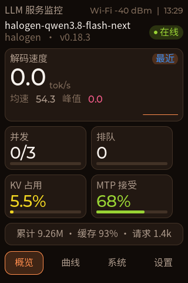
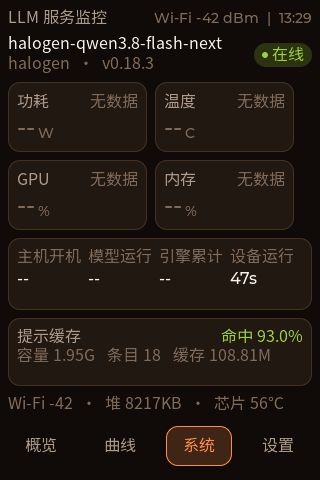
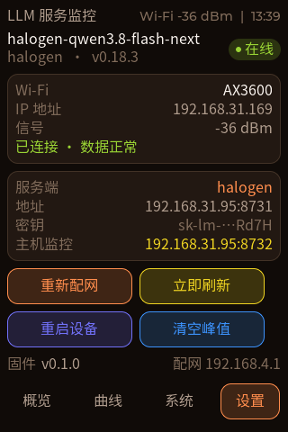
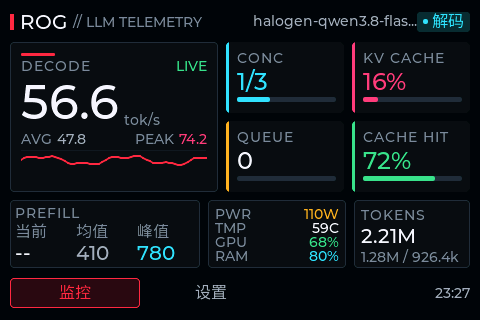
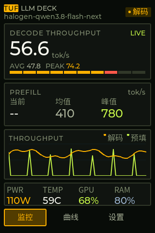
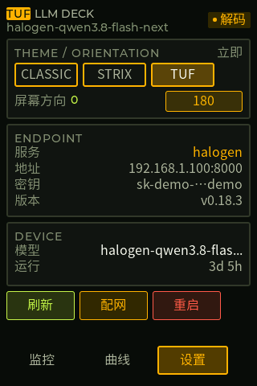
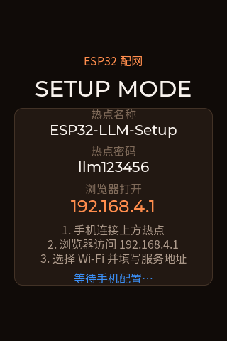

# ESP32-S3 LLM Server Dashboard

English | [简体中文](README.md)

A 3.5-inch touch screen dashboard for a local LLM inference server. Once connected to Wi-Fi, the board polls your LLM API and shows decode/prefill TPS, concurrency, queue depth, KV cache usage, MTP acceptance rate, token usage and history charts. Provisioning is done from a phone browser, and the firmware speaks to halogen / gufo / strata / LM Studio / Ollama out of the box — or reads the public **halogen-panel (port 8800)** API directly, no key required.

It ships with three themes — **Classic / STRIX (480×320 landscape) / TUF (portrait)** — switchable from the settings page, plus a runtime 180° flip. The same UI sources compile into a headless PC simulator, so layout work does not require flashing.

> Hardware: Waveshare **ESP32-S3-Touch-LCD-3.5-C** (ESP32-S3R8, 16 MB flash + 8 MB PSRAM, 320×480 ST7796 SPI panel + FT6336 touch)

## Screenshots

| Overview | System | Settings |
| --- | --- | --- |
|  |  |  |

Two esports-style themes (switchable in settings; STRIX is 480×320 landscape):

| STRIX (landscape, ROG-inspired) | TUF (portrait, industrial amber) | Theme & orientation settings |
| --- | --- | --- |
|  |  |  |

Provisioning overlay (shown automatically when Wi-Fi is unavailable):



## Features

- **Live metrics** — decode/prefill TPS (computed from counter deltas, not gauges), average & peak speed, in-flight requests, queue depth, KV usage, MTP acceptance, cumulative tokens/requests, prompt-cache hit rate and size
- **Panel direct mode** — read halogen-panel's public `/api/status` on `:8800` (no key) for model/version, TPS, KV, concurrency and hardware in one request; the panel URL can also be used as the host monitor address to fill gaps for a 8731 primary source
- **History charts** — speed / KV / concurrency / power, switchable by touch
- **System page** — power draw, GPU temperature, GPU utilisation, RAM, host/model/engine uptime, device uptime
- **Phone provisioning** — SoftAP + captive portal with Wi-Fi scan, server URL, API key; saves to NVS and reboots
- **Self-healing Wi-Fi** — keeps retrying in the background after a failed boot connect, and hides the provisioning overlay once online
- **Three themes** — Classic (320×480) / STRIX (480×320 landscape) / TUF (320×480), switchable in settings and persisted in NVS
- **Orientation** — theme default plus 180° flip, applied as a runtime hardware rotation
- **Headless PC simulator** — iterate on layout without flashing; includes automatic checks for out-of-bounds, overlapping siblings, text overflow and low contrast
- **Serial console** — frame capture, stats, page/theme switching, render and animation benchmarks
- **Performance** — ~50 ms full-screen redraw (~20 fps), 47 fps partial updates; see “Performance” below

## Supported APIs

| Service | Probe endpoints | Metrics available |
| --- | --- | --- |
| **halogen-panel (8800)** | `/api/status` | model/version, live & average TPS, slots/context, in_flight/queued, KV, MTP, GPU/RAM/uptime (public, no key) |
| **halogen** | `/health` + `/metrics` | model/version, slots, context, in_flight/queued, KV pool, token counters, MTP, cache |
| **gufo** | `/health` + `/v1/slots` | same as above; falls back to `n_decoded` deltas when `/metrics` is absent |
| **strata** | `/api/monitor` | outputTps / promptTps / queue / context / hardware.* / totals.* / engine start time |
| **LM Studio** | `/api/v0/models` | model, quantisation, context |
| **Ollama** | `/api/ps` | loaded models, size, context |
| **OpenAI-compatible** | `/v1/models` | model list |

The provider defaults to `auto` (probed in the order above) and can be pinned in the provisioning page (`panel` for port 8800).
The panel's `/api/usage`, `/api/params`, `/api/logs` and TTS/embedding endpoints remain password-protected and are never read by the firmware.

> TPS note: gauges such as `llamacpp:predicted_tokens_seconds` read 0 on some servers, so the dashboard always derives live speed from the deltas of `tokens_predicted_total` and `tokens_predicted_seconds_total`.

## Where do hardware metrics come from?

LLM APIs do **not** expose GPU power, temperature, utilisation or RAM (halogen's `/metrics` contains inference counters only), so those fields come from a small host-side agent. On the machine running the model:

```bash
python3 firmware/tools/host_agent.py --port 8732 --model-match halogen
```

Then fill in the host monitor address `http://<host-ip>:8732` on the provisioning page. The agent uses the standard library only: with an NVIDIA GPU it shells out to `nvidia-smi` (power/temperature/utilisation/VRAM), otherwise it reads Linux `hwmon` and `/proc/meminfo`. Without it the corresponding cards simply show "no data".

If **halogen-panel (`:8800`)** is already running on that machine, you do not need `host_agent.py`: put the panel URL `http://<ip>:8800` into the host monitor field. The firmware tries `/stats` first, then falls back to the panel's `/api/status`, filling power, temperature, GPU, RAM and uptime; when the primary source's `/metrics` needs a key (e.g. 8731), TPS / KV / MTP are taken from the panel as well. To use the panel as the only source, set the API base URL to `http://<ip>:8800`, pick provider `panel`, and leave the key empty.

## Quick start

### 1. Build and flash the firmware

Requires ESP-IDF v5.5.x (validated on v5.5.6):

```bash
. ~/esp/esp-idf/export.sh
cd firmware
idf.py set-target esp32s3
idf.py build
idf.py -p /dev/cu.usbmodem21401 flash
```

The first build downloads LVGL 9.6, `esp_lvgl_port` and friends through the component manager (`main/idf_component.yml`).

### 2. Provision

1. Join the `ESP32-LLM-Setup` hotspot (password `llm123456`)
2. Open `http://192.168.4.1` (the captive portal usually pops up by itself)
3. Pick your Wi-Fi, enter the API base URL and key, optionally the host agent address
4. Save — the board reboots and connects

Serial provisioning is also available:

```
w <ssid>|<password>
c <url>|<api-key>
o <url>          # optional host monitor, may point at the 8800 panel
```

### 3. PC simulator (optional)

```bash
./sim/fetch_lvgl.sh          # clones LVGL 9.3 into lvgl/
./render.sh out/dashboard.png

# page / scenario / theme / 180° flip
./render.sh out/strix.png 0 live 1 0      # STRIX monitor page
./render.sh out/tuf_trend.png 1 live 2 0  # TUF trend page
```

Arguments:

```
render.sh <out.png> [page] [scenario] [theme] [rot180]
  page      Classic 0-3; STRIX 0-1; TUF 0-2
  scenario  live | offline | empty
  theme     0=Classic 1=STRIX 2=TUF
  rot180    0/1
```

Each render also audits out-of-bounds objects, overlapping siblings, text overflow and low contrast.

## Serial console commands

| Command | Action |
| --- | --- |
| `s` | Capture one frame, output as base64 PNG |
| `h` | Print FPS / heap / PSRAM / internal RAM / Wi-Fi / IP / RSSI |
| `p <n>` | Switch page (numbering depends on theme) |
| `t <0-2>` | Switch theme (0 Classic, 1 STRIX, 2 TUF) |
| `r` | Flip 180° |
| `b` | Benchmark a full-screen refresh (including SPI) |
| `B` | Split render/transfer: `render=… full=… transfer~…` |
| `C` | Blank-screen baseline (fill + SPI) |
| `a` / `A` | Small-area / full-screen animation FPS over 5 s |
| `w <ssid>\|<pass>` | Write Wi-Fi credentials and reboot |
| `c <url>\|<key>` | Write API base URL and key, then reboot |
| `o <url>` | Write host monitor URL (or the 8800 panel) and reboot; `o -` clears it |

Companion capture script (uses the pyserial bundled with ESP-IDF):

```bash
~/.espressif/python_env/idf5.5_py3.12_env/bin/python firmware/tools/capture.py \
    --cmd "p 2" --out /tmp/board.png
```

## Performance

Measured on the board (480×320 logical resolution):

| Scenario | Result |
| --- | --- |
| Blank full-screen fill + SPI | 31 ms |
| Real dashboard full redraw | 50–53 ms (42 ms render + 7 ms SPI, ~20 fps) |
| Partial / full-screen solid animation | 47 fps |
| UI data apply | < 30 ms |
| Free internal RAM | 33–38 KB |

Key settings (`firmware/sdkconfig.defaults` and `firmware/main/display.c`):

- `CONFIG_COMPILER_OPTIMIZATION_PERF=y` (do not keep the default `-Og`)
- 240 MHz CPU + **32 KB instruction cache** (16 KB makes rendering 3× slower)
- LVGL draw buffers in internal SRAM with DMA, 1/12 screen ×2, `max_transfer_sz` sized to one chunk
- `LV_COLOR_FORMAT_RGB565_SWAPPED`, removing the 300 KB/frame CPU byte swap
- `LV_DEF_REFR_PERIOD=16` for snappier touch and small-area updates

> A 480×320 RGB565 frame is 300 KB; 80 MHz SPI caps out around 32 fps. A complex dashboard
> full redraw at ~20 fps is expected, while partial updates reach 47 fps. A full-frame PSRAM
> buffer with direct DMA is not viable for SPI panels on ESP32-S3 (DMA cannot read PSRAM).

## Repository layout

```
.
├── ui/                 # Shared UI: design tokens, widgets, Classic/STRIX/TUF themes
│   ├── include/ui.h
│   ├── include/ui_theme.h
│   ├── include/dash_model.h
│   └── src/{ui_widgets,ui_dashboard,ui_theme_strix,ui_theme_tuf,font_cjk_16}.c
├── sim/                # Headless PC simulator (LVGL → framebuffer → PNG)
│                        # main.c takes theme/flip args, ui_audit.c checks layout defects
├── firmware/           # ESP-IDF project
│   ├── main/           # display/touch drivers, Wi-Fi, portal, metrics, console
│   ├── components/     # on-board ST7796 / FT6336 drivers
│   ├── tools/          # capture.py, host_agent.py
│   ├── docs/DEBUGGING.md
│   ├── partitions.csv
│   └── sdkconfig.defaults
├── docs/images/        # README screenshots
├── render.sh           # one-shot simulator render
└── LICENSE
```

`ui/` is compiled by both the firmware (`firmware/main/CMakeLists.txt` references `../../ui`) and the PC simulator, so what you see on the desktop is exactly what runs on the board.

## Board notes

| Function | Pin / setting |
| --- | --- |
| LCD SPI | MOSI=GPIO1, SCLK=GPIO5, DC=GPIO3, **CS/RST not wired** |
| LCD reset | via TCA9554 (I2C 0x20) pin 1, driven low for 120 ms at boot |
| Backlight | GPIO6, LEDC PWM @ 5 kHz |
| Touch | FT6336 (I2C 0x38), SDA=GPIO8, SCL=GPIO7 |
| Panel | 320×480, RGB565, BGR + inverted + `mirror_x`, `sw_rotate=0` |

Bring-up notes, PSRAM framebuffer strategy and serial capture troubleshooting live in
[firmware/docs/DEBUGGING.md](firmware/docs/DEBUGGING.md).

## Known limitations

- A full-screen redraw costs ~50 ms (~20 fps); partial updates reach 47 fps. Page/theme switches are one-off full draws
- Without the host agent, power/temperature/GPU/RAM and host uptime show "no data"; pointing the host field at the 8800 panel removes the need for that agent
- In panel mode `TOKENS` and `CACHE HIT` show "—": those values live in the panel's login-protected `/api/usage` or the engine's key-protected `/metrics`
- The bundled CJK font covers 415 common characters (`ui/src/font_cjk_16.c`); rare glyphs will be missing
- `sim/` uses LVGL 9.3 while the firmware uses LVGL 9.6; the APIs are compatible but the simulator prints a few deprecation warnings
- Switching themes rebuilds the LVGL screen, which takes a few hundred milliseconds

## License

[MIT](LICENSE)
